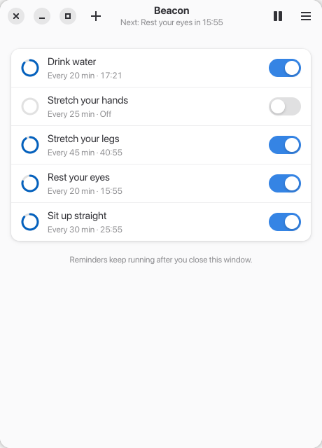
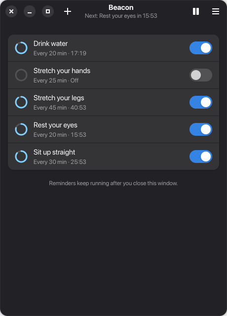
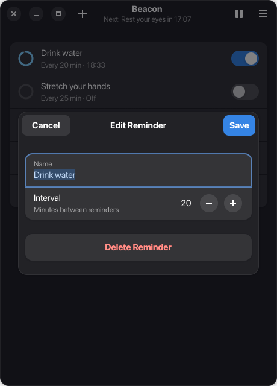
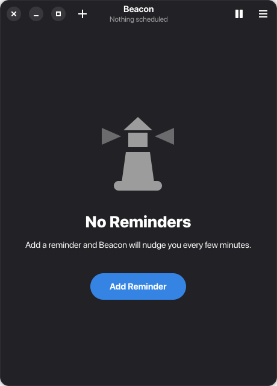

<p align="center">
  
</p>

<h1 align="center">Beacon</h1>

<p align="center">
  Gentle reminders for GNOME.<br>
  Every few minutes, a nudge to drink water, rest your eyes or stretch.<br>
  Then the clock starts over.
</p>

<p align="center">
  
  
</p>

## Features

- **Native GNOME.** GTK 4 and libadwaita: follows your light/dark style,
  accent color, fonts, high contrast and window button layout.
- **Your reminders.** Each one has its own interval (1 to 240 minutes).
  Add, rename, delete (with Undo) and turn them on or off.
- **Real notifications.** Reminders arrive as GNOME notifications with a
  **Snooze** button. Click the notification to open Beacon.
- **Pause everything** with one click, or `Ctrl+P`.
- **Runs in the background.** Closing the window keeps the reminders going.
  Beacon starts with your session (you can turn that off in Preferences).
- **Sleep aware.** After the computer wakes up, the clocks start over
  quietly instead of firing a backlog of notifications.
- **Translated** into English, Spanish, Portuguese, French, German and
  Italian, following the desktop language.

<p align="center">
  
  
</p>

## Install

### Arch Linux

```sh
git clone https://github.com/mauneven/beacon
cd beacon/packaging/arch
makepkg -si
```

### From source

Needs Rust (1.88 or newer), GTK 4.18+ and libadwaita 1.8+ (GNOME 49 or newer).

```sh
# Fedora:  sudo dnf install cargo gtk4-devel libadwaita-devel
# Debian/Ubuntu: sudo apt install cargo libgtk-4-dev libadwaita-1-dev
# Arch:    sudo pacman -S rust gtk4 libadwaita

git clone https://github.com/mauneven/beacon
cd beacon
make
sudo make install            # into /usr/local
# or, without root:
make install PREFIX=~/.local
```

Then open **Beacon** from the Activities overview.

To remove it: `sudo make uninstall` (or `make uninstall PREFIX=~/.local`).

## Use it

1. **Click a reminder** to rename it or change its interval.
2. **Flip the switch** to turn a reminder on or off. The ring shows how much
   time is left.
3. **Close the window.** The reminders keep running. Use **Quit** in the menu
   (`Ctrl+Q`) to stop them until the next login.

| Key            | Action              |
| -------------- | ------------------- |
| `Ctrl+N`       | New reminder        |
| `Ctrl+P`       | Pause or resume     |
| `Ctrl+,`       | Preferences         |
| `Ctrl+?`       | Keyboard shortcuts  |
| `Ctrl+W`       | Close the window    |
| `Ctrl+Q`       | Quit and stop reminders |

## Light on resources

Beacon is two small programs:

- **`beacon-daemon`** keeps the clocks and sends the notifications. It links
  only GLib/GIO, never GTK, and arms a single timer for the next reminder
  instead of waking up every second. It is D-Bus activated, so it starts
  on demand.
- **`beacon`** is the window. It only exists while it's open, and talks to
  the daemon over D-Bus.

| State                     | Memory (PSS) |
| ------------------------- | ------------ |
| In the background         | ~1.5 MB      |
| Window open               | ~50 MB       |

Measured on GNOME with `/proc/<pid>/smaps_rollup`. Closing the window gives
all of its memory back.

<details>
<summary><b>Config file</b></summary>

Beacon saves everything to `~/.config/beacon/config.toml`. You don't need to
edit it, but you can. Open Beacon afterwards to apply the change.

```toml
paused = false
snooze_minutes = 5

[[reminder]]
id = 1
preset = "water"       # built in: the name follows the desktop language
minutes = 20
enabled = true

[[reminder]]
id = 6
name = "Feed the cat"  # your own name: never translated
minutes = 90
enabled = true
```

</details>

<details>
<summary><b>D-Bus interface</b></summary>

The daemon owns `io.github.mauneven.Beacon.Daemon` on the session bus and
exports `io.github.mauneven.Beacon.Daemon1` at
`/io/github/mauneven/Beacon/Daemon`:

| Member         | Description                                        |
| -------------- | -------------------------------------------------- |
| `GetDeadlines` | `a(ux)`: each running reminder and its deadline (Unix ms) |
| `Reload`       | Re-read the config file                            |
| `Snooze(u)`    | Push a reminder's next notification out            |
| `Quit`         | Stop the daemon                                    |
| `Changed`      | Signal: the clocks changed                         |

```sh
gdbus call --session --dest io.github.mauneven.Beacon.Daemon \
  --object-path /io/github/mauneven/Beacon/Daemon \
  --method io.github.mauneven.Beacon.Daemon1.GetDeadlines
```

</details>

<details>
<summary><b>Translations</b></summary>

Each language is a small TOML file in [`i18n/`](i18n). To add one, copy
`i18n/en.toml` to `i18n/<code>.toml`, translate the values (keep every
`{placeholder}`), and add the file to `LANGUAGES` in
[`src/i18n.rs`](src/i18n.rs). `cargo test` checks that no key is missing.

</details>

<details>
<summary><b>Development</b></summary>

```sh
cargo run --bin beacon       # starts the daemon from target/ if needed
cargo test
cargo clippy --all-targets
```

Without an installed desktop file GNOME Shell drops the daemon's
notifications, so install with `make install PREFIX=~/.local` to try those.

</details>

## License

Beacon is free software, released under the
[GNU General Public License v3.0 or later](LICENSE).
